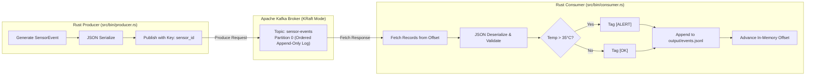

# Kafka Event Pipeline


Distributed event-driven data pipeline built with Rust and Apache Kafka (KRaft mode). Built as a distributed systems college assignment exploring message queues, event-driven architectures, message delivery guarantees, and monotonic ordering.

[](https://github.com/akritbisht4-hash/kafka-rust-pipeline/actions/workflows/ci.yml)

-black?logo=apachekafka)


---

## Table of Contents
- [What Was Built](#what-was-built)
- [Architecture & Data Flow](#architecture--data-flow)
- [Core Concepts & Themes](#core-concepts--themes)
  - [1. Event-Driven Thinking & Decoupling](#1-event-driven-thinking--decoupling)
  - [2. Message Delivery Semantics (At-Least-Once)](#2-message-delivery-semantics-at-least-once)
  - [3. Message Ordering & Partition Log](#3-message-ordering--partition-log)
  - [4. Fault Tolerance & Resilient Startup](#4-fault-tolerance--resilient-startup)
- [Project Structure](#project-structure)
- [How to Run](#how-to-run)
  - [Option A: Docker Compose (Recommended)](#option-a-docker-compose-recommended)
  - [Option B: Local Rust Development](#option-b-local-rust-development)
  - [Configuration via Environment Variables](#configuration-via-environment-variables)
- [Testing Suite](#testing-suite)
- [Push Blocking & CI/CD](#push-blocking--cicd)
  - [Local Git Pre-Push Hook](#local-git-pre-push-hook)
  - [GitHub Actions CI/CD](#github-actions-cicd)
- [Design Decisions](#design-decisions)

---

## What Was Built

A full-stack, distributed producer-consumer pipeline:
1. **Producer (`src/bin/producer.rs`)**: Emits structured IoT sensor events (`SensorEvent`) with randomized temperature, humidity, and timestamps to the Kafka topic `sensor-events`.
2. **Kafka Broker (`docker-compose.yml`)**: Single-node Apache Kafka 3.7 running modern **KRaft mode** (no ZooKeeper dependency).
3. **Consumer (`src/bin/consumer.rs`)**: Reads the partition log sequentially from the earliest offset, deserializes and validates payloads, evaluates an alert condition (triggers `ALERT` when temperature > 35.0°C), and appends formatted records to `output/events.jsonl`.

---

## Architecture & Data Flow



---

## Core Concepts & Themes

### 1. Event-Driven Thinking & Decoupling
- **Temporal Decoupling**: The producer and consumer run on independent event loops and lifecycles. If the consumer stops or crashes, messages accumulate safely in Kafka's committed log without dropping sensor data.
- **Backpressure Protection**: The consumer pulls messages at its own pace using `fetch_records` batches rather than having records forcefully pushed to it.

### 2. Message Delivery Semantics (At-Least-Once)
- The consumer reads a batch of records, validates them, evaluates alerting rules, and flushes them to disk before advancing its read cursor (`offset = kafka_offset + 1`).
- If an unhandled crash occurs mid-batch, the next consumer restart replays from the last successfully processed offset, preventing message loss.

### 3. Message Ordering & Partition Log
- Kafka guarantees total order within a single partition.
- Each event is assigned a monotonically increasing 64-bit integer offset (`0, 1, 2, ...`).
- Consumer polls sequentially from `OffsetAt::Earliest`, ensuring that events are processed and written to storage in the exact order they were published by the producer.

### 4. Fault Tolerance & Resilient Startup
- Both producer and consumer implement an exponential/linear retry loop (up to 30 attempts, 2-second intervals). This ensures graceful self-healing during cold starts on low-resource machines where the Kafka broker takes 10–15 seconds to finish metadata synchronization.

---

## Project Structure

```
kafka-rust-pipeline/
├── .github/
│   └── workflows/
│       └── ci.yml              # CI workflow (cargo fmt, clippy, tests)
├── .githooks/
│   └── pre-push                # Git hook blocking pushes if tests fail
├── scripts/
│   └── setup-hooks.sh          # One-step hook configuration script
├── src/
│   ├── bin/
│   │   ├── consumer.rs         # Consumer application entrypoint
│   │   └── producer.rs         # Producer application entrypoint
│   └── lib.rs                  # Core data models, validation, alert logic & 15 unit tests
├── tests/
│   └── pipeline_integration_test.rs # Integration test suite
├── docker-compose.yml          # Container orchestration (Kafka + Producer + Consumer)
├── Dockerfile                  # Multi-stage Dockerfile for reproducible builds
├── Cargo.toml                  # Rust dependencies & binary targets
├── Cargo.lock                  # Pinned dependency versions
└── README.md                   # Comprehensive project documentation
```

---

## How to Run

### Option A: Docker Compose (Recommended)

Requires Docker and Docker Compose installed.

1. **Start the complete pipeline**:
   ```bash
   docker compose up --build
   ```
   Docker will build the Rust binaries inside a Debian Bookworm builder stage, launch the KRaft Kafka broker, await the broker health check, and start both the producer and consumer.

2. **Inspect processed output in real-time**:
   ```bash
   cat output/events.jsonl
   ```
   Sample output:
   ```text
   [OK] {"sensor_id":"sensor-1","temperature_c":22.4,"humidity_pct":45.1,"timestamp_ms":1711234567890}
   [ALERT] {"sensor_id":"sensor-3","temperature_c":38.9,"humidity_pct":78.3,"timestamp_ms":1711234568090}
   ```

3. **Tear down**:
   ```bash
   docker compose down -v
   ```

### Option B: Local Rust Development

If you prefer running natively with Cargo (requires a local or Docker-hosted Kafka broker):

1. **Start only the Kafka broker**:
   ```bash
   docker compose up kafka -d
   ```
   *(Broker exposed to host on `localhost:29092`)*

2. **Run consumer in terminal 1**:
   ```bash
   KAFKA_BROKERS=localhost:29092 cargo run --bin consumer
   ```

3. **Run producer in terminal 2**:
   ```bash
   KAFKA_BROKERS=localhost:29092 EVENT_COUNT=50 INTERVAL_MS=150 cargo run --bin producer
   ```

### Configuration via Environment Variables

| Variable | Default | Description |
|---|---|---|
| `KAFKA_BROKERS` | `localhost:9092` | Comma-separated list of Kafka broker addresses |
| `KAFKA_TOPIC` | `sensor-events` | Kafka topic name |
| `EVENT_COUNT` | `100` | Total events generated by producer before graceful exit |
| `INTERVAL_MS` | `200` | Delay between produced events in milliseconds |
| `OUTPUT_PATH` | `output/events.jsonl` | Storage destination file for consumer |
| `MAX_EVENTS` | `None` (unlimited) | Optional limit on events consumer processes before exiting |
| `RUST_LOG` | `info` | Logging verbosity (`error`, `warn`, `info`, `debug`, `trace`) |

---

## Testing Suite

The project includes **15 unit tests** and **2 integration tests** verifying data serialization, boundary validation, domain alert logic, and malformed payload rejection.

Run tests locally:
```bash
cargo test
```

Test coverage includes:
- `test_serialization_roundtrip`: Verifies bidirectional JSON serialization without data mutation.
- `test_validation_rejects_bad_temp`: Rejects extreme high temperatures (> 80°C).
- `test_validation_rejects_extreme_cold_temp`: Rejects extreme low temperatures (< -50°C).
- `test_validation_rejects_bad_humidity`: Rejects humidity > 100%.
- `test_validation_rejects_negative_humidity`: Rejects negative humidity (< 0%).
- `test_validation_rejects_empty_sensor_id`: Rejects empty sensor IDs.
- `test_validation_rejects_whitespace_sensor_id`: Rejects whitespace-only sensor IDs.
- `test_validation_rejects_zero_or_negative_timestamp`: Rejects non-positive timestamps.
- `test_alert_detection_high_temp`: Asserts `is_alert()` triggers above 35.0°C.
- `test_no_alert_normal_temp`: Asserts `is_alert()` is false for normal temperatures.
- `test_process_event_marks_alert_and_formats`: Verifies `[ALERT]` tag applied.
- `test_format_for_storage_ok_prefix`: Verifies `[OK]` tag applied.
- `test_from_json_rejects_malformed`: Ensures corrupted messages or schema mismatches are safely dropped.
- `test_datetime_conversion`: Validates UTC conversion from milliseconds.
- `test_random_event_is_valid`: Invariant test verifying generated random events always pass validation.
- `test_pipeline_normal_event_flow`: Integration test for end-to-end normal telemetry processing.
- `test_pipeline_alert_event_flow`: Integration test for end-to-end alert telemetry processing.

---

## Push Blocking & CI/CD

The assignment requires:
> *"Use GitHub Actions for CI/CD. Add basic test cases as well (at least 4) and block pushing of code if they fail."*

This repository satisfies this constraint both **locally** and **remotely**:

### Local Git Pre-Push Hook
A Git pre-push hook is included in `.githooks/pre-push`. Whenever a developer runs `git push`, the hook automatically executes `cargo test`. If any test fails, **the push is aborted immediately**:

```bash
# Enable the pre-push hook (one-time setup)
./scripts/setup-hooks.sh
```

**Demonstration of blocked push on failure:**
```text
==========================================
 Running pre-push checks (cargo test)...
==========================================
   Compiling kafka-rust-pipeline v0.1.0
   ...
test tests::test_validation_rejects_bad_temp ... FAILED

failures:
    tests::test_validation_rejects_bad_temp

❌ PUSH BLOCKED: Test suite failed.
Please resolve failing tests before pushing.
==========================================
error: failed to push some refs to 'github.com:akritbisht4-hash/kafka-rust-pipeline.git'
```

### GitHub Actions CI/CD
The remote pipeline (`.github/workflows/ci.yml`) runs on every `push` and `pull_request` to `main` and `master`:
1. **Formatting verification**: `cargo fmt --check`
2. **Strict linting**: `cargo clippy -- -D warnings`
3. **Automated test execution**: `cargo test --verbose`

#### Enforcing Branch Protection on GitHub:
To guarantee failing code cannot be merged remotely:
1. Go to repository **Settings** → **Branches**.
2. Click **Add branch protection rule** for `master` (or `main`).
3. Check **Require status checks to pass before merging**.
4. Search for and select the status check: `Build & Test`.
5. Check **Do not allow bypassing the above settings**.

---

## Design Decisions

1. **Why Rust & `rskafka`?**
   - Traditional Kafka clients in Python or Go wrap the C library `librdkafka`, which adds heavy native build requirements (`cmake`, `libssl-dev`, etc.).
   - `rskafka` is 100% pure Rust using async Tokio sockets. The final Docker container is ~70MB, with low idle memory consumption (<15MB RAM).
2. **Why Kafka in KRaft Mode?**
   - Kafka KRaft eliminates ZooKeeper, significantly reducing CPU and memory overhead while speeding up cluster recovery and partition leadership elections.
3. **Multi-Stage Docker Builds**:
   - Ensures dynamic linking compatibility between compilation and runtime environments, avoiding Linux glibc mismatches between host distributions and container bases.

