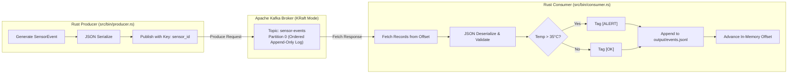

# Kafka Event Pipeline in Rust

Distributed event-driven data pipeline built with Rust and Apache Kafka (KRaft mode). Built as a distributed systems college assignment exploring message queues, event-driven architectures, message delivery guarantees, and monotonic ordering.

[](https://github.com/yadavayush834/kafka-rust-pipeline/actions/workflows/ci.yml)

-black?logo=apachekafka)


---

## Table of Contents
- [What Was Built](#what-was-built)
- [Architecture & Data Flow](#architecture--data-flow)
- [Core Concepts & Themes](#core-concepts--themes)
  - [1. Event-Driven Thinking & Decoupling](#1-event-driven-thinking--decoupling)
  - [2. Message Delivery Semantics (At-Least-Once)](#2-message-delivery-semantics-at-least-once)
  - [3. Message Ordering & Partition Log](#3-message-ordering--partition-log)
  - [4. Fault Tolerance & Resilient Startup](#4-fault-tolerance--resilient-startup)
- [Project Structure](#project-structure)
- [How to Run](#how-to-run)
  - [Option A: Docker Compose (Recommended)](#option-a-docker-compose-recommended)
  - [Option B: Local Rust Development](#option-b-local-rust-development)
  - [Configuration via Environment Variables](#configuration-via-environment-variables)
- [Testing Suite](#testing-suite)
- [Push Blocking & CI/CD](#push-blocking--cicd)
  - [Local Git Pre-Push Hook](#local-git-pre-push-hook)
  - [GitHub Actions CI/CD](#github-actions-cicd)
- [Design Decisions](#design-decisions)

---

## What Was Built

A full-stack, distributed producer-consumer pipeline:
1. **Producer (`src/bin/producer.rs`)**: Emits structured IoT sensor events (`SensorEvent`) with randomized temperature, humidity, and timestamps to the Kafka topic `sensor-events`.
2. **Kafka Broker (`docker-compose.yml`)**: Single-node Apache Kafka 3.7 running modern **KRaft mode** (no ZooKeeper dependency).
3. **Consumer (`src/bin/consumer.rs`)**: Reads the partition log sequentially from the earliest offset, deserializes and validates payloads, evaluates an alert condition (triggers `ALERT` when temperature > 35.0°C), and appends formatted records to `output/events.jsonl`.

---

## Architecture & Data Flow



---

## Core Concepts & Themes

### 1. Event-Driven Thinking & Decoupling
- **Temporal Decoupling**: The producer and consumer run on independent event loops and lifecycles. If the consumer stops or crashes, messages accumulate safely in Kafka's committed log without dropping sensor data.
- **Backpressure Protection**: The consumer pulls messages at its own pace using `fetch_records` batches rather than having records forcefully pushed to it.

### 2. Message Delivery Semantics (At-Least-Once)
- The consumer reads a batch of records, validates them, evaluates alerting rules, and flushes them to disk before advancing its read cursor (`offset = kafka_offset + 1`).
- If an unhandled crash occurs mid-batch, the next consumer restart replays from the last successfully processed offset, preventing message loss.

### 3. Message Ordering & Partition Log
- Kafka guarantees total order within a single partition.
- Each event is assigned a monotonically increasing 64-bit integer offset (`0, 1, 2, ...`).
- Consumer polls sequentially from `OffsetAt::Earliest`, ensuring that events are processed and written to storage in the exact order they were published by the producer.

### 4. Fault Tolerance & Resilient Startup
- Both producer and consumer implement an exponential/linear retry loop (up to 30 attempts, 2-second intervals). This ensures graceful self-healing during cold starts on low-resource machines where the Kafka broker takes 10–15 seconds to finish metadata synchronization.

---

## Project Structure

```
kafka-rust-pipeline/
├── .github/
│   └── workflows/
│       └── ci.yml              # CI workflow (cargo fmt, clippy, tests)
├── .githooks/
│   └── pre-push                # Git hook blocking pushes if tests fail
├── scripts/
│   └── setup-hooks.sh          # One-step hook configuration script
├── src/
│   ├── bin/
│   │   ├── consumer.rs         # Consumer application entrypoint
│   │   └── producer.rs         # Producer application entrypoint
│   └── lib.rs                  # Core data models, validation, alert logic & 15 unit tests
├── tests/
│   └── pipeline_integration_test.rs # Integration test suite
├── docker-compose.yml          # Container orchestration (Kafka + Producer + Consumer)
├── Dockerfile                  # Multi-stage Dockerfile for reproducible builds
├── Cargo.toml                  # Rust dependencies & binary targets
├── Cargo.lock                  # Pinned dependency versions
└── README.md                   # Comprehensive project documentation
```

---

## How to run

### 1. Prereqs (Omarchy / Arch)
```bash
sudo systemctl enable --now docker
sudo usermod -aG docker $USER
newgrp docker
```

### 2. Run full pipeline
```bash
docker compose up --build
# in another terminal:
cat output/events.jsonl
# [OK] {"sensor_id":"sensor-1",...}
# [ALERT] {"sensor_id":"sensor-2","temperature_c":38.2,...}
```

Services:
- Kafka inside compose: `kafka:9092`
- Kafka from host: `localhost:29092`

### 3. Run locally (without Docker, needs Kafka up)
```bash
cargo test
KAFKA_BROKERS=localhost:29092 cargo run --bin consumer &
KAFKA_BROKERS=localhost:29092 EVENT_COUNT=50 cargo run --bin producer
```

### 4. Tests
```bash
cargo test
# 8 tests: serialization roundtrip, validation (temp/humidity/id), alert true/false, process+format, malformed JSON rejection
```

### 5. CI/CD
Push to `main` runs GitHub Action. Enable branch protection in GitHub:
Settings → Branches → Add rule for `main` → Require status checks → `test` → block merge if tests fail.

## Why Rust + rskafka?
- Pure-Rust client (`rskafka 0.6`) — no `cmake` / `librdkafka` system deps, tiny runtime (~5-10MB vs Python 50-80MB)
- Static binaries in `debian:bookworm-slim` image
- `tokio` async producer/consumer, retry loop for slow Kafka startup on low-RAM machines

## Reproduce
1. `docker compose up --build`
2. Wait 20s for Kafka healthy, producer logs `produced event offset=N`
3. Consumer logs `consumed offset=N [ALERT]/[OK]`
4. Check ordering: offsets increase monotonically in `output/events.jsonl`
